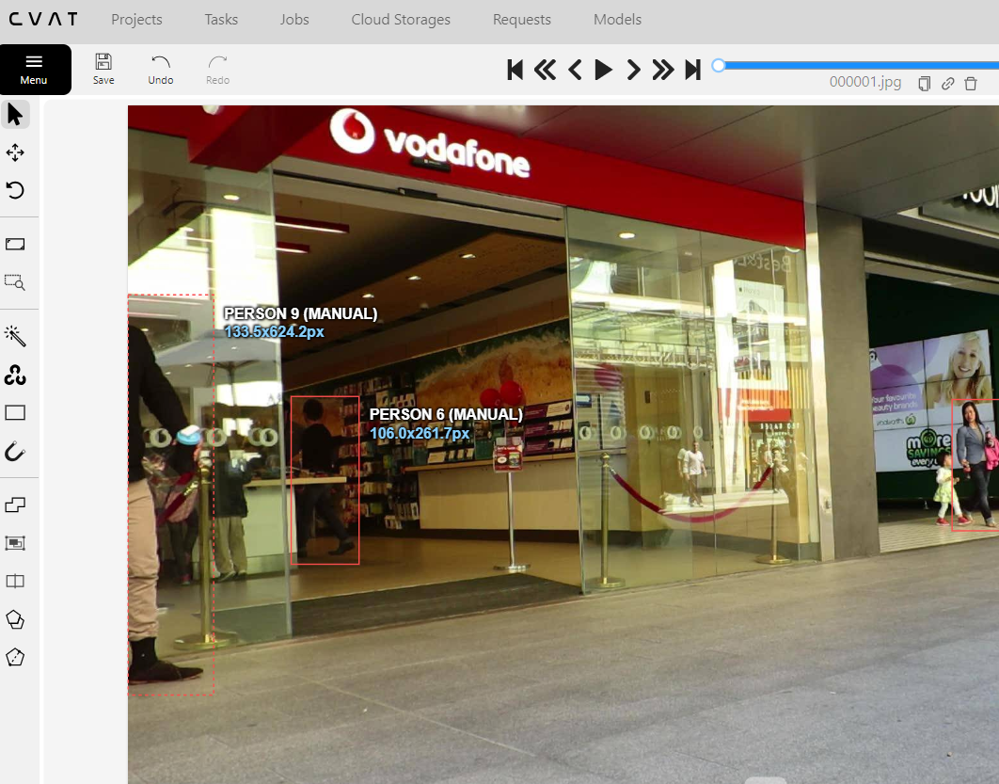
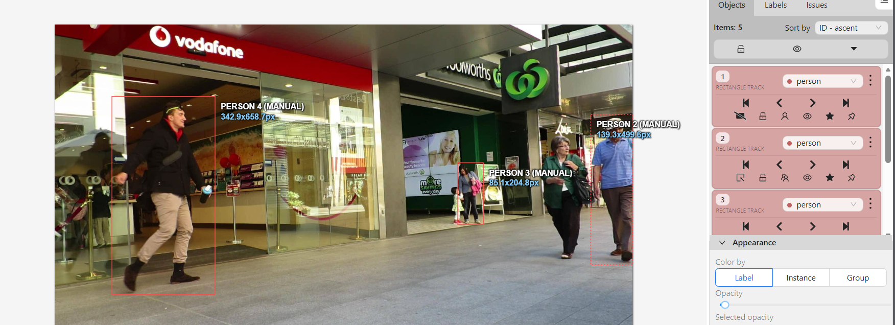
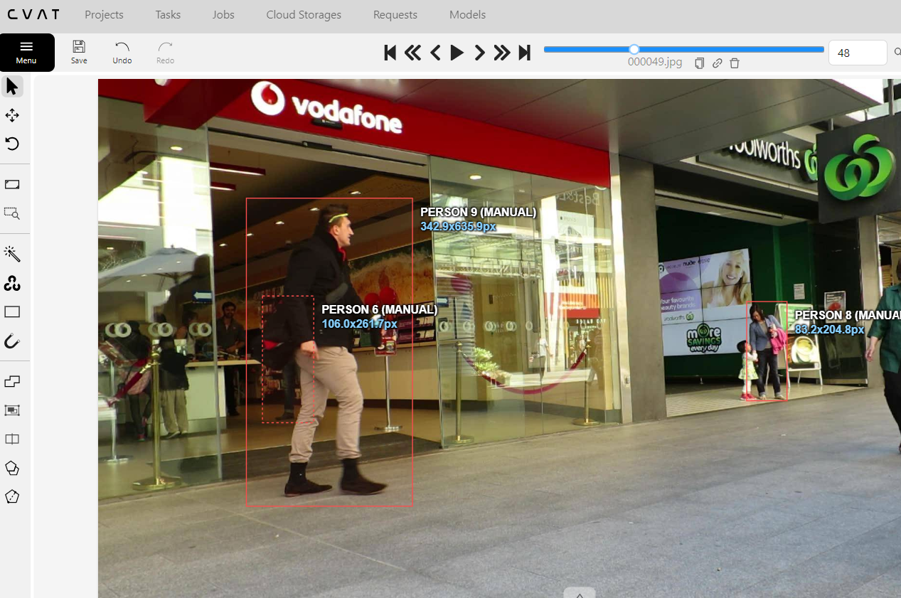

# Báo cáo cá nhân — HoVaTen-MSSV

Đổi tên file theo quy tắc `MSSV_HoTen.md`. Ví dụ: `20241234_NguyenVanAn.md`.

Đoạn video: MOT17-09, 150 frame (frame 1–150), nguồn MOTChallenge, giấy phép CC BY-NC-SA 3.0.

## 0. Thông tin học viên

- Họ tên: Phạm Trọng Hiện
- MSSV: 2A202603218
- Mã đề (A/B/C): C
- Email:hienpt.uia@gmail.com
- Link repository:https://github.com/phmhienn/K5-L2-DAY05-PhamTrongHien-2A202603218-MOTTracking.git
- Giờ bắt đầu:16h10 13/11/2026
- Giờ kết thúc:18H00 13/11/2026

## 1. Xem trước đoạn video (CP0)

Ghi **trước khi vẽ**, mỗi người một dòng.

| Mã  | Frame xuất hiện | Frame cuối thấy được | Rẽ / dừng / đổi tốc độ ở frame | Bị che ở frame | Ghi chú |
| --- | --------------- | -------------------- | ------------------------------ | -------------- | ------- |
| P1  | 0               | 149                  | 67                             | 32-61, 38-47   |         |
| P2  | 61              | 149                  | 72                             | không          |         |
| P3  | 40              | 149                  | không                          | không          |         |
| P4  | 2               | 106                  | 39                             | 106            |         |
| P5  | 28              | 136                  | không                          | 136            |         |

## 2. Keyframe và thời gian (CP1, CP4)

Số keyframe lấy từ kết quả `src/check_submission.py`.

| Mã       | Số keyframe | Keyframe ở frame                                                                                          | Số frame có mặt | Keyframe / 100 frame | Thời gian (phút) | Chỗ khó |
| -------- | ----------- | --------------------------------------------------------------------------------------------------------- | --------------- | -------------------- | ---------------- | ------- |
| P1       | 14          | 0, 10, 20, 32, 48, 52, 62, 72, 82, 94, 104, 124, 135, 148                                                 | 140             | 10                   | 5                |         |
| P2       | 24          | 0, 10, 20, 21, 32, 42, 52, 62, 72, 82, 83, 94, 104, 114, 124, 135, 137, 138, 139, 140, 143, 146, 147, 149 | 150             | 16                   | 5                |         |
| P3       | 7           | 0, 10, 21, 42, 52, 94, 104                                                                                | 107             | 6.5                  | 5                |         |
| P4       | 16          | 0, 10, 20, 22, 32, 42, 52, 62, 72, 82, 83, 94, 104, 114, 124, 135                                         | 137             | 11.7                 | 5                |         |
| P5       | 10          | 62, 72, 82, 94, 104, 114, 124, 135, 140, 148                                                              | 88              | 11.4                 | 5                |         |
| **Tổng** | 71          |                                                                                                           | 622             |                      |                  |         |

Keyframe / 100 frame của cả bài = tổng keyframe ÷ tổng số frame có mặt × 100 = ...

Bạn đặt keyframe nhiều nhất ở người nào? Vì sao (người đó rẽ, dừng, lại gần camera hay bị che)?

Ở P3 vì người di chuyển liên tục

## 3. Đoạn bị che (CP2)

Người bị che: `P1`

| Mốc                                      | Frame |
| ---------------------------------------- | ----: |
| Bắt đầu bị che một phần (bật `occluded`) |    32 |
| Mất hẳn (bật `outside`)                  |    38 |
| Hiện lại (tắt `outside`)                 |    48 |
| Thấy rõ trở lại (tắt `occluded`)         |    62 |

- Thời gian khuất hẳn: **10 frame = 0.33** giây.
- Quyết định: giữ cùng ID
- Lý do (trả lời 3 câu: khuất bao lâu so với 60 frame, ngoại hình có khớp, chỗ hiện lại có đúng hướng và tốc độ):
  Thời gian khuất 10 frame, ngắn hơn ngưỡng 60 frame của lớp. Khớp ngoại hình , rẽ hướng cùng tốc độ

Ảnh chụp màn hình:





## 4. Tự review ID (CP3)

Lượt 1 theo người (đi ngược từ frame 149 về 0 trên CVAT), lượt 2 theo cảnh (nhảy 10 frame). Ít nhất 3 dòng; không có lỗi thì ghi một dòng "đã kiểm hai lượt, không lỗi".

Loại lỗi dùng đúng một trong 7 mã: `id_switch`, `fragmentation`, `lost`, `merge`, `false_track`, `drift`, `flag`.

| Frame | Mã người | Loại lỗi | Mô tả một câu | Phát hiện ở lượt | Đã sửa? |
| ----: | -------- | -------- | ------------- | ---------------- | ------- |
|       |          |          |               |                  |         |
|       |          |          |               |                  |         |
|       |          |          |               |                  |         |

Đã kiểm 2 lượt không có lỗi

Tổng hợp số lỗi theo loại:

| `id_switch` | `fragmentation` | `lost` | `merge` | `false_track` | `drift` | `flag` |
| ----------: | --------------: | -----: | ------: | ------------: | ------: | -----: |
|             |                 |        |         |               |         |        |

Lỗi nào chỉ lượt 2 (theo cảnh) mới thấy, lượt 1 (theo người) không thấy? Vì sao?

...

## 5. File xuất và kết quả tự kiểm (CP4)

| Kiểm tra                                                  | Kết quả |
| --------------------------------------------------------- | ------- |
| Tên file MOT 1.1                                          | done    |
| Tên file CVAT for video 1.1                               | done    |
| Số track ID khác nhau trong `gt/gt.txt` (phải là 5)       | done    |
| Frame `outside` không có dòng trong `gt.txt` (đúng / sai) | đúng    |
| Job đã completed trên CVAT máy cá nhân                    | done    |

Dán phần tóm tắt in ra từ `src/check_submission.py`:

```text
=== Tóm tắt ===
  Lỗi: 0   |   Cảnh báo: 0
  Đạt. Dán phần tóm tắt này vào báo cáo mục 5.
```

## 6. Ba câu kết

1. Nếu được gán lại, bạn sẽ đặt keyframe khác ở đâu? Vì sao?

Nếu gán lại, tôi sẽ xem kỹ P3 ở frame 137–149, nơi tôi đã đặt nhiều keyframe liên tiếp. Tôi sẽ giữ những keyframe cần để box bám đúng người và bỏ bớt keyframe nếu nội suy giữa chúng vẫn chính xác.

2. Có chỗ nào bạn không chắc "cùng ID hay ID mới"? Bạn đã quyết định và ghi chú thế nào?
   Không
3. Một lỗi ID trong job của bạn (nếu không còn sót, chọn lỗi đã sửa) có thể làm xe tự lái dự đoán sai chuyển động của người đó như thế nào? Lỗi đó ảnh hưởng MOTA hay IDF1 nhiều hơn?
   Hệ thống dự đoán chuyển động có thể hiểu nhầm người cũ đã biến mất và một người mới xuất hiện. Lỗi kéo dài qua nhiều frame như vậy ảnh hưởng IDF1 rõ hơn MOTA.

## Bonus (nếu làm)

### B1 — Hai người đi sát

...

### B2 — So cách đặt keyframe

| Cách đặt           | Số keyframe | Frame trôi nhất | Ghi chú |
| ------------------ | ----------: | --------------: | ------- |
| Đều mỗi 30 frame   |             |                 |         |
| Theo chỗ đổi hướng |             |                 |         |

...

### B3 — So với tracker có sẵn

| Frame | Mã người | Tracker làm gì | Nhãn của bạn | Giải thích (đoán rồi sửa / ghép IoU / box score thấp / ngoại hình) |
| ----: | -------- | -------------- | ------------ | ------------------------------------------------------------------ |
|       |          |                |              |                                                                    |
|       |          |                |              |                                                                    |

## 7. Tài liệu tham khảo và công cụ AI đã dùng

...
